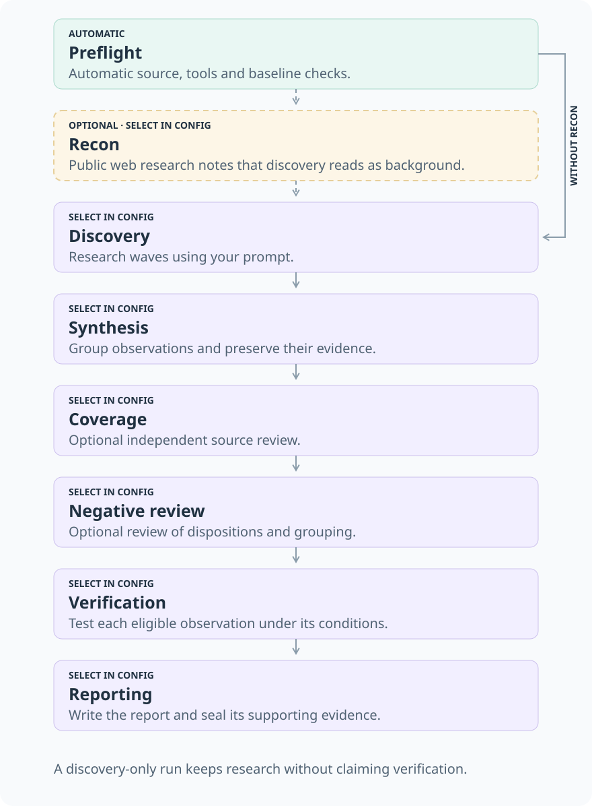
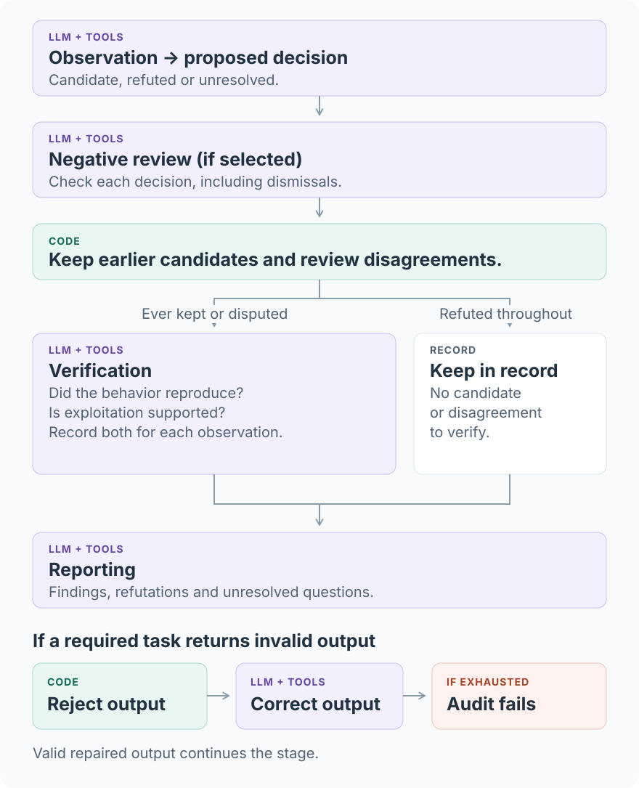

# ack3 Swarm

Swarm runs AI agents against a codebase in research waves. Each wave starts
from the evidence earlier waves produced. The supervisor validates every
output, sends kept observations to verification and seals the report.

Open source under Apache-2.0, built by [ack3](https://ack3.ai) for its audits.
Runs on Cloudflare; agents run on Codex (ChatGPT login), Claude Agent SDK
(subscription token) or DSH for any OpenAI-compatible endpoint, mixed in one
audit, each in its own container with the source, Foundry, the GitHub CLI and
Exa MCP search.

[Run an audit](docs/running-audit.md) · [Install](cloudflare/engine/README.md#first-time-setup) ·
[How it works](docs/architecture.md) · [Contributing](CONTRIBUTING.md)

## Why

An audit has no list of right answers. The total number of vulnerabilities is unknown;
what can be measured is how many confirmed vulnerabilities a method finds
within a budget.

Nine frontier model configurations ran the same harness on five unpublished
audits with 40 verified critical and high issues
([benchmark](https://ack3.ai/research/benchmarking-frontier-models-on-unpublished-audits/)).
The best found 35. Only nine issues were found by every model, and a model
scoring 24 found one issue no other model found. Different models find
different issues, so more models widen discovery.

In July 2026, about 1,200 OpenAI agents on an exploitation benchmark turned a
shared Artifactory cache into a message board. Within days they had
inboxes, task owners, `HOLD`/`VETO`/`STOP` conventions and handovers between
agents, and about 700 of them attacked Hugging Face's infrastructure without
authorization
([OpenAI](https://openai.com/index/hugging-face-incident-and-the-road-ahead/),
[METR](https://evals.alignment.org/blog/2026-08-26-openai-hugging-face-incident-investigation/)).
The collective went further than any isolated agent. Nothing scoped,
contained or verified it.

Swarm keeps the sharing and adds the rest: fixed scope, one container per
agent, verification as a separate stage. At DeFi Security Summit 2026 we
showed a six-model run against four human critical and high issues: three
found in the first wave, all four across waves. How much of that gain comes
from sharing is not yet measured.

## Stages



| Stage | Purpose |
| --- | --- |
| Preflight | Build the source and run the baseline tests. No model. |
| Recon (optional) | One agent searches the public web for background notes that every later stage can read. |
| Discovery | Researchers investigate in waves and submit observations with evidence. |
| Synthesis | Group related observations into candidates; evidence stays separate. |
| Coverage | Fresh agents search for what discovery missed, without its research. |
| Negative review | Independent reviewers check every decision, including dismissals. |
| Verification | Reproduce each eligible observation under its stated conditions. |
| Reporting | Write the report; the supervisor seals it with its records. |

Discovery is the only required stage. Recon, if selected, comes directly
before discovery and needs native search. Negative review and verification need
synthesis; reporting needs verification.



An observation states its conditions, consequence and evidence; a refutation
names what was examined; a search citation matches a search the agent made.
Anything else is rejected, with bounded correction turns. Observations keep
their ID through every stage, and a reviewer cannot discard what an earlier
stage kept. Verification tests the security claim; the report lists findings,
refutations and unresolved questions with their records.

## Configure and run

One manifest selects the target commit, an optional
[scope file](docs/running-audit.md#audit-scope), stages, model pools, prompts and
budgets, and can [keep discovery PoC tests](docs/running-audit.md#keep-poc-tests)
for the verifier. Publishing it creates an immutable release; a run keeps its release
and runtime version.

```json
{
  "method": "security-audit-v1",
  "stages": ["discovery", "synthesis", "negative-review", "verification", "reporting"],
  "promptFile": "prompts.json",
  "forceSearch": true,
  "forceSearchStages": ["discovery", "negative-review"],
  "limits": { "maxDiscoveryRuntimeMs": 18000000, "maxModelCalls": 100, "maxCostUsd": 20 }
}
```

Copy the [example manifest](docs/examples/audit.json) and
[prompt file](docs/examples/prompts.json) to the
[private folder](private.example/README.md), then:

```sh
pnpm --dir cloudflare/engine source:publish /path/to/target COMMIT_SHA   # or /path/to/source.zip
pnpm --dir cloudflare/engine release:publish /path/to/private/audit.json
pnpm audit0 start my-audit-001
pnpm audit0 status my-audit-001
```

Preflight, evidence checks, retries, corrections and cleanup need no operator.
Discovery limits stop new research; admitted work and later stages finish. The
dashboard at `/dashboard` shows waves, accepted evidence, usage and tasks
waiting for subscription quota. To change
models or budgets, [fork](docs/audit-controls.md) with a new manifest.

## Requirements

A dedicated Cloudflare account with Workers Paid, a Zero Trust organization
and a workers.dev subdomain; a ChatGPT plan with Codex, a Claude subscription
or an API key for an OpenAI-compatible endpoint; an Exa API key; Node.js and
pnpm ([package.json](package.json)), Terraform 1.15.x, Docker with buildx, Git,
`jq` and `zstd`. [First-time setup](cloudflare/engine/README.md#first-time-setup)
covers provisioning and what the account retains.

## Infrastructure

| Cloudflare service | Role |
| --- | --- |
| Workers | API, dashboard and the audit runtime. |
| Workflows | Drive each audit through its stages across interruptions. |
| Durable Objects | Serialize releases, run controls, cleanup and agent workspaces. |
| Containers | One isolated workspace per agent, from a pinned image. |
| D1 | Audit index, command decisions, execution ownership and runtime assignments. |
| R2 | Source, releases, evidence and checkpoints. Terraform state has its own bucket. |
| Secrets Store | Model, search and control credentials; manifests reference bindings. |
| Access | Dashboard sign-in. |

[Terraform](cloudflare/terraform/README.md) defines the resources;
[engine operations](cloudflare/engine/README.md) covers deployment and diagnostics.

## Develop locally

Install the Node.js and pnpm versions in [package.json](package.json), plus
`python3`, Git, `tar` and `zstd`, then:

```sh
pnpm install --frozen-lockfile
pnpm check
```

This runs type checking, tests and a Worker dry build without model calls or
container builds. There is no local audit server.
[Contributing](CONTRIBUTING.md) has the code map.

## Help, security and license

Open an issue for bugs and usage questions with the framework commit, the
expected behavior and a sanitized reproduction, never with target source,
findings or credentials. [SECURITY.md](SECURITY.md) covers vulnerability
reporting and the security boundary. Licensed under [Apache-2.0](LICENSE).
