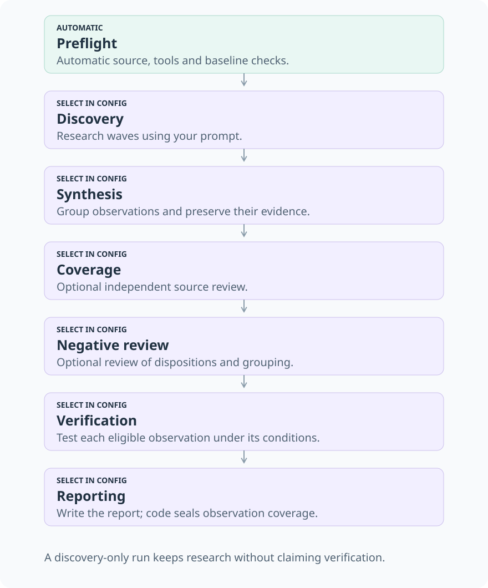
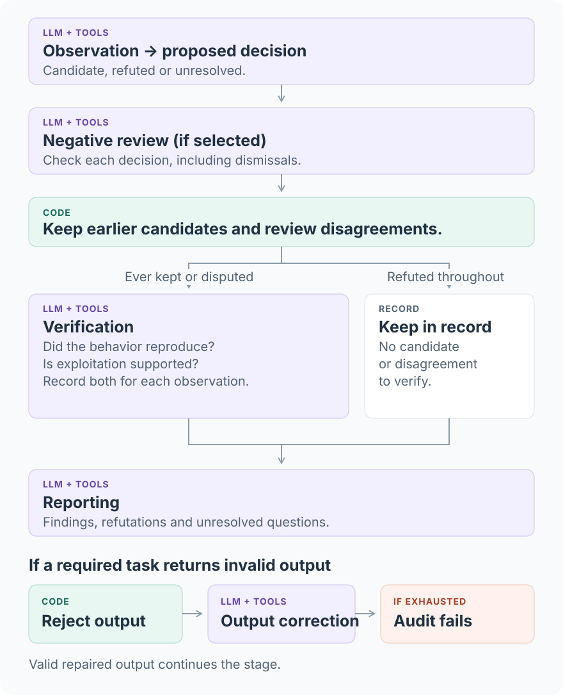

# Swarm

Multi-agent security audits of pinned source code. Agents investigate and test;
the supervisor schedules work, validates outputs and saves evidence. Audits run
in isolated Cloudflare containers with an EVM toolchain.

[Run an audit](docs/running-audit.md) · [Architecture](docs/architecture.md) ·
[Operations](cloudflare/engine/README.md) · [Contributing](CONTRIBUTING.md)

## Stages and agent roles



| Stage | Purpose |
| --- | --- |
| Preflight | Check source, tools and baseline tests without a model. |
| Discovery | Investigate possible vulnerabilities over research waves. |
| Synthesis | Group observations without losing their evidence. |
| Coverage | Independently look for missed issues. |
| Negative review | Check observations and the reasons they were kept or dismissed. |
| Verification | Test eligible observations against their original conditions and evidence. |
| Reporting | Present supported findings, refutations and unresolved questions. |

Agents use Codex, DSH or Claude SDK runners to inspect source, execute tests and search the
web through Exa MCP. The image built from the [Dockerfile](cloudflare/engine/Dockerfile) includes Foundry for building and testing Solidity.
[Model pools](docs/running-audit.md#agent-runners-and-model-pools) assign runners
and models; [search settings](docs/running-audit.md#search) control which decisions
require search. Returned evidence helps agents test concerns against target code.
Each task starts a fresh conversation with source and prior evidence as files;
output corrections continue in that conversation.

## Issue lifecycle



**Accepted output** has passed format and evidence checks; that does not establish
that its security claims are correct. Reviewers do not vote away earlier evidence:
references kept at any earlier stage, and conflicting review outcomes, go to
Verification. Grouping related observations preserves their individual evidence.

Completion means the selected stages finished; a discovery-only run has no reviewed report.
Even a reviewed report can contain unresolved questions.
[Architecture](docs/architecture.md#evidence-and-decisions) explains these decisions.

## Configure and run

Use a provisioned Swarm service; for a new install, follow
[First-time setup](cloudflare/engine/README.md#first-time-setup) first. Copy the [example configuration](docs/examples/audit.json)
and [prompt file](docs/examples/prompts.json) to your private folder
([template](private.example/README.md)), then set
your source, models and budgets. Choose stages independently of research prompts:

```json
{
  "method": "security-audit-v1",
  "stages": ["discovery", "synthesis", "negative-review", "verification", "reporting"],
  "promptFile": "prompts.json",
  "forceSearch": true,
  "forceSearchStages": ["discovery", "negative-review"],
  "limits": { "maxDiscoveryRuntimeMs": 18000000, "maxModelCalls": 100, "maxCostUsd": 20 }
}
```

Publish source separately from the container image. Discovery limits stop new
research; admitted work and later stages still finish. Follow
[Run an audit](docs/running-audit.md) for credentials, source upload, publication
and start/stop commands.

## Infrastructure

| Cloudflare service | Purpose |
| --- | --- |
| Workers | Serve the API and dashboard and execute audit runtime code. |
| Workflows | Coordinate long-running audits across execution steps. |
| Durable Objects | Coordinate release activation and runtime reservations. |
| Containers and Container Registry | Run isolated agent workspaces from pinned images. |
| D1 | Index audits, releases and runtime assignments. |
| R2 | Store source, releases, evidence and checkpoints; keep Terraform state separately. |
| Secrets Store | Supply credentials without embedding them in source. |
| Access | Protect dashboard sign-in. |
| Workers Logs and Analytics | Diagnose failures and inspect resource usage. |

[Architecture](docs/architecture.md#services-and-ownership) shows how these fit
together. Code deployment uses Wrangler/CLI/API; infrastructure resources and new
services belong in Terraform. The included [Terraform configuration](cloudflare/terraform/README.md)
defines the resources; [Operations](cloudflare/engine/README.md) covers deployment
and [image builds](cloudflare/engine/README.md#local-container-builds).

## Develop locally

Install the Node.js and pnpm versions specified in [package.json](package.json) and `python3`, then:

```sh
pnpm install --frozen-lockfile
pnpm check
```

This runs type checking, tests and a Worker dry build, without paid model calls or
container builds. `pnpm audit0:acceptance` runs only the deterministic audit-flow tests.
There is no supported end-to-end local audit server: the engine's `dev` command
uses `wrangler dev --remote`. See [Contributing](CONTRIBUTING.md) for code navigation
and change validation.

## License and security

[Apache-2.0](LICENSE). See [Security](SECURITY.md) for reporting vulnerabilities
and handling private source, credentials and audit results.
