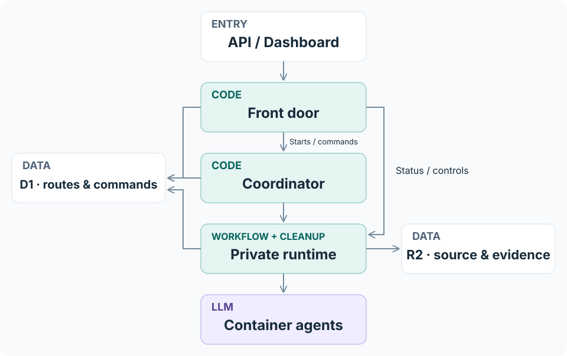

# How Swarm works

## Services

The front-door Worker authenticates API requests, serves the dashboard and
routes each command to the runtime that owns the run. Its Durable Object
serializes release activation, runtime reservations and command delivery.

A runtime Worker executes audits. Each runtime slot has its own Workflow,
container image and coordinator; the coordinator reconciles commands and cleans
up when a run ends. A run keeps the runtime it started on, so publishing code
never changes a run in progress. Code rotation deploys to an idle slot.

R2 stores source packages, releases, evidence and checkpoints. D1 holds the run
index, command revisions, execution ownership and runtime assignments.
See [engine operations](../cloudflare/engine/README.md).

## Releases

| Concept | Purpose |
| --- | --- |
| Audit method | Code that schedules stages and validates outputs (`security-audit-v1`). |
| Prompt file | Research instructions per stage, plus optional replacements for the default agent instructions. |
| Manifest | Target commit, optional scope, stages, model pools, environment, prompts and limits. |
| Sealed release | The compiled manifest and prompts under a content digest. |
| Runtime release | A Worker version, Workflow and container image digest. |

Publishing a manifest creates an immutable release. Activation selects it for
future starts and leaves existing runs alone. Prompt file edits take effect at
the next publication.

## Evidence flow

Preflight and evidence validation always run; the research stages are
selected in the manifest ([stages](../README.md#stages)).

**Recon** (optional) runs one agent before discovery. It searches the public
web and writes background notes about the target's technologies, dependencies
and similar attacks, citing at least one successful search. It reports no
findings; later stages treat the notes as unverified context.

**Discovery** produces observations: a statement, the conditions under which it
holds, its consequence, its evidence and, where search is required, the queries
made. The supervisor accepts a submission when every observation has those
parts, every refutation names what was examined, and every search citation
matches a search made in that session. Otherwise the agent gets a bounded
number of correction turns in the same conversation.

**Synthesis** groups observations into candidates, refutations and unresolved
questions. Every observation keeps its ID and origin.

**Coverage** sends fresh agents through the source without the discovery
research.

**Negative review** gives each reviewer the same saved observations in a
separate workspace. A reviewer upholds, narrows, overturns or leaves a decision
unresolved, and each decision is kept. A reference kept at any earlier stage,
or one reviewers disagree about, goes to verification. Observations refuted at
every stage stay in the record.

**Verification** records two results per eligible observation: whether the
behavior reproduced and whether exploitation is supported. With
[`keepPocs`](running-audit.md#keep-poc-tests), it also receives the PoC tests
written during discovery, as leads to check and rerun.

**Reporting** maps every eligible observation to a section of the report. The
supervisor checks completeness and seals `finding.md` with its supporting
records. The report states where verification was inconclusive.

## Workspaces

Every task starts a fresh model conversation; correction turns stay in it.
Discovery keeps one workspace per model pool and researcher across waves. The
first wave sees the source and, with recon, its notes; later waves also
receive, as files, all research accepted so far from every pool. Pools advance independently. Later
stages use fresh workspaces with the evidence assigned to them. Rejected and
unfinished outputs are never shared.

A source package is the pinned commit with its submodules, without Git history
or uncommitted files. [Workspace preparation](running-audit.md#workspace-preparation)
runs before any credential is installed; preflight runs separately.

Agents write a research document and `.swarm/submission.json`. Accepted
artifacts are immutable, and R2 lock rules stop Swarm from deleting releases,
source packages, checkpoints and accepted artifacts. A token that can edit
bucket settings could remove the rules; such tokens belong to account
administrators. [Remove one audit's data](remove-audit-data.md) lists where an
audit's data is and how an administrator removes it.

## Limits and recovery

Discovery stops admitting work at the time, usage or wave limit, or when the
pools go quiet (saturation stopping, on by default). Admitted tasks finish and
later stages run. A Claude task that reaches its subscription limit waits for
the reported reset and then resumes the same session; the wait does not count
against discovery time, and the dashboard shows it.

Checkpoints save accepted evidence, attempts, usage and execution position. To
change models, prompts or budgets, publish a new manifest and fork the run from
a stage, a checkpoint or its frontier. The child keeps the accepted prefix, the
original clocks and the recorded usage; the parent is unchanged. Usage
interrupted without a receipt is recorded as unknown.
See [run controls](audit-controls.md).
