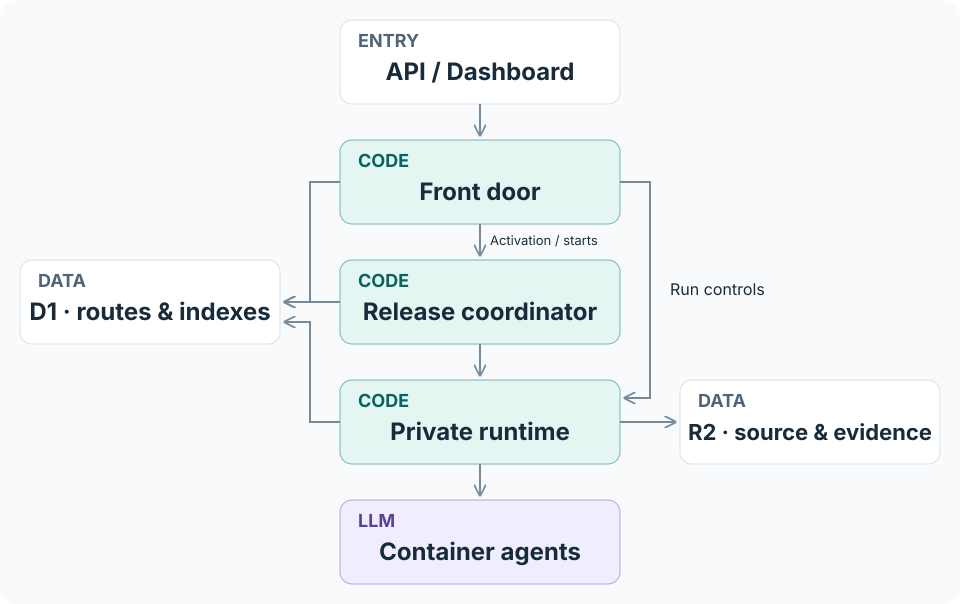

# Architecture

## Services and ownership

The front-door Worker authenticates API requests, serves the dashboard and routes
controls to the run's pinned runtime. A Durable Object serializes release
activation and runtime reservations. Private runtime Workers execute Workflows,
validate outputs and manage container workspaces. R2 stores source and evidence;
D1 holds indexes and runtime assignments.

Each run keeps its Worker version and container image. Routine code publication
does not change active runs. Terraform manages infrastructure resources; deployment
tools publish code and runtime versions. See [Operations](../cloudflare/engine/README.md).

## Configuration and releases

| Concept | Purpose |
| --- | --- |
| Audit method | Implements scheduling and output validation. |
| Prompt file | Supplies user research instructions keyed by stage. |
| Audit configuration (manifest) | Selects stages, source, models, environment, prompts and limits. |
| Sealed release | Saves the compiled configuration under a content digest. |
| Runtime release | Identifies the Worker version, Workflow and container image. |

Publishing a configuration creates an immutable release. Activation selects it
for future starts; it does not modify existing runs. Changes to a prompt file
do not change already sealed releases.

## Evidence and decisions

The [stage overview](../README.md#stages-and-agent-roles) lists selectable stages.
Preflight and evidence validation are automatic; only selected research stages run.
Research produces observations with evidence. Synthesis organizes them into
candidate issues, refutations and unresolved questions. Independent coverage
agents investigate source without seeing that research.

Reviewers receive the same saved observations and evidence in separate workspaces.
Their decisions are retained individually. Verification receives references kept
at any earlier stage and conflicting review outcomes, even if later reviewers
agree to refute an earlier candidate. Observations refuted throughout remain in
the audit record.

Verification covers each eligible reference–observation
pair. It records whether the behavior reproduces and whether it is exploitable as two
separate results.

The reporter maps every eligible pair to a section of `finding-draft.md`.
The supervisor checks coverage and seals `finding.md` with supporting records.
These checks establish output completeness, not the correctness of security claims.
A completed report can include uncertainty; missing required work fails the run.

## Conversations and filesystems

Each task starts a fresh model conversation. Invalid output receives bounded
correction turns in the same session and workspace. Execution failures have
separate retry handling.

Discovery workspaces are reused by model pool and researcher across waves.
The first wave receives source only; later waves receive previously accepted
research as files. Pools progress independently, so equal wave numbers need not
share start times or inputs. Later stages use fresh workspaces with their assigned
evidence. Rejected and unfinished outputs are not shared as accepted research.

Source packages contain the pinned commit and submodules, without Git history or
uncommitted files. Workspace preparation runs before credentials are installed.
Preflight checks are separate and do not install dependencies in agent workspaces.
See [workspace preparation](running-audit.md#workspace-preparation).

Agents write reports and `.swarm/submission.json`. Accepted artifacts are immutable;
observation IDs and references preserve their origin across stages. R2 lock rules
keep Swarm from deleting releases, source packages, checkpoints and accepted
artifacts, but a Cloudflare token that can change bucket settings can remove the
rules, so keep such tokens to account administrators. Conversation IDs do not
guarantee that workspace files survive a container failure.

## Limits and recovery

Time, usage and wave limits stop new Discovery admissions; saturation stopping
is configurable. Admitted
work drains and later stages continue, so a discovery budget is not a total audit
timeout.

Checkpoints preserve accepted evidence, attempts, usage and execution position.
Recovery creates a child run and preserves its ancestry; it is not a fresh audit.
Interrupted usage without a receipt remains unknown. See
[recovery procedures](../cloudflare/engine/README.md#checkpoints-and-recovery).
